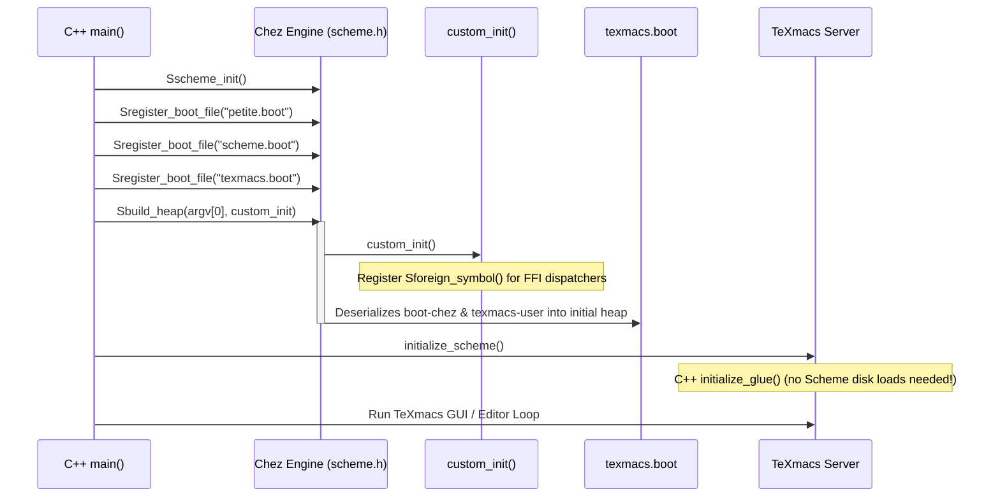

# Architecture Plan: `make-boot-file` (`texmacs.boot`)

## Executive Summary

Currently, TeXmacs Chez Scheme startup requires loading `boot-chez.so` followed by hundreds of compiled module `.so` files (or `texmacs-user.so`) via filesystem lookups (`primitive-load`). While ahead-of-time compiled, this still incurs substantial disk I/O, individual FASL deserializations, and dynamic linking overhead during every startup.

By using Chez Scheme's native `make-boot-file`, we can bundle the foundational Scheme runtime and core application modules into a single binary heap image (`texmacs.boot`). During startup, the Chez C-engine loads this image in a single sequential heap-build operation (`Sbuild_heap`), reducing cold Scheme bootstrap time to near zero.

```
+----------------------------------------------------------------------------------+
|                              texmacs.boot                                        |
|  Prerequisites: '("petite" "scheme")                                             |
|                                                                                  |
|  +--------------------+  +-------------------------+  +-----------------------+  |
|  |    boot-chez.so    |  |     texmacs-user.so     |  | (Optional: Full Tier) |  |
|  |  Foundational FFI, |  |  Core kernel modules    |  | Remaining top-level   |  |
|  |  primitives, I/O   |  |  (GUI, styles, modes)   |  | application modules   |  |
|  +--------------------+  +-------------------------+  +-----------------------+  |
+----------------------------------------------------------------------------------+
                                        |
                                        v
                            Sregister_boot_file()
                                        |
                                        v
                                  Sbuild_heap()
```

---

## 1. Technical Mechanics of Chez Boot Files

In Chez Scheme:
- A `.boot` file contains pre-compiled, pre-expanded Scheme code serialized into heap images.
- A secondary boot file specifies base prerequisite boot files (e.g., `'("petite" "scheme")`).
- Boot files are registered with the C engine using `Sregister_boot_file()` before `Sbuild_heap()` is invoked.
- `Sbuild_heap(argv[0], custom_init)` reads and instantiates the heap objects directly into memory before Scheme execution starts.

The Scheme API to produce this is:
```scheme
(make-boot-file out-path '("petite" "scheme") input-so-file ...)
```

---

## 2. Key Lifecycle & Architectural Requirements

### A. Foreign Symbol Registration (`custom_init`)
Chez Scheme resolves foreign procedure addresses at the time `foreign-procedure` forms are evaluated:
- Currently, `Sforeign_symbol("tm-call-by-name", ...)` is called inside `initialize_scheme()` **after** `Sbuild_heap()`.
- If `boot-chez.so` is bundled into `texmacs.boot`, its `(foreign-procedure "tm-call-by-name" ...)` forms will be evaluated during `Sbuild_heap()`.
- **Requirement:** Move all `Sforeign_symbol(...)` registrations into `custom_init()` in `chez_tm.cpp`. Chez guarantees `custom_init()` is executed by `Sbuild_heap()` *before* loading boot files.



### B. C++ Glue Separation
- C++ glue procedures (`initialize_glue()`) cannot be inside the `.boot` image because they are compiled C++ functions registered dynamically.
- However, the Scheme-side receiver (`tm-install-procedure!`) will already be in the heap from `texmacs.boot`.
- When `initialize_scheme()` runs, it immediately proceeds to `initialize_glue()`, with zero file loading required.

### C. Runtime Bypass in `init-texmacs-chez.scm`
When `chez_has_boot()` is true:
- Core kernel modules bundled in `texmacs.boot` are already resident in the interaction environment.
- `init-texmacs-chez.scm` detects this state and bypasses loading `texmacs-user.so` or the individual kernel module list, jumping straight to late-stage user preferences and window initialization.

---

## 3. Implementation Steps

### Phase 1: Engine Preparation in C++ (`chez_tm.cpp`)
1. **Move FFI symbol registrations:**
   Extract all `Sforeign_symbol` calls from `initialize_scheme()` into `custom_init()`:
   ```cpp
   static void
   custom_init (void) {
     Sforeign_symbol ("tm-call-by-name", (void*) tm_call_by_name);
     Sforeign_symbol ("tm_fast_call_0", (void*) tm_fast_call_0);
     // ... all fast_call and blackbox foreign entry points ...
   }
   ```
2. **Auto-detect default `texmacs.boot` location:**
   Extend `start_scheme()` to probe for:
   - Explicit environment variable: `$TEXMACS_BOOT_FILE`
   - Build/bundled path: `$TEXMACS_BOOT_PATH/texmacs.boot` or `$TEXMACS_PATH/boot/texmacs.boot`

### Phase 2: Compiler Integration (`compile-texmacs.scm`)
Add a dedicated generator stage after Pass 2 finishes compiling and verifying modules:
```scheme
(define (build-texmacs-boot-file)
  (let* ((boot-file (boot-path "texmacs.boot"))
         (boot-chez (boot-path "kernel/boot/boot-chez.so"))
         (user-so   (boot-path "texmacs-user.so")))
    (when (and (file-exists? boot-chez) (file-exists? user-so))
      (log-progress-pct "Generating" "texmacs.boot image")
      (make-boot-file boot-file
                      '("petite" "scheme")
                      boot-chez
                      user-so)
      (log-progress-pct "Verified" "texmacs.boot"))))
```

### Phase 3: Runtime Bootstrap Adaptation (`init-texmacs-chez.scm`)
Guard the module loading sequence so that if `(top-level-bound? 'texmacs-booted-from-image?)` (or `(chez-has-boot?)`) is set, loading of core snapshot modules is bypassed:
```scheme
(unless (top-level-bound? '*texmacs-boot-loaded*)
  ;; Only load modules from disk if not already initialized in the boot image
  (load-core-modules-or-snapshot!))
```

### Phase 4: Packaging & Bundling (`make-bundle.sh`)
Update `packages/macos/make-bundle.sh` to copy `texmacs.boot` alongside the other boot artifacts:
```bash
if [ -f "$SRC_BOOT/texmacs.boot" ]; then
  cp -p "$SRC_BOOT/texmacs.boot" "$SHARE/boot/texmacs.boot"
fi
```

---

## 4. Expected Benefits & Verification

| Metric | Current AOT Setup (`.so` files) | With `texmacs.boot` Image |
|---|---|---|
| **Filesystem `open`/`read` calls** | ~454 file descriptors | 1 file descriptor (`texmacs.boot`) |
| **Scheme engine bootstrap** | ~64 - 96 ms | **~5 - 15 ms** |
| **Startup memory fragmentation** | Multiple incremental FASL heap allocations | Single contiguous heap allocation |
| **Deployment surface** | Hundreds of loose `.so` files | 1 unified boot image + non-core plugin `.so`s |

### Verification Protocol
1. **Verification of build:** `make-boot-file` completes with 0 errors and generates a non-empty `texmacs.boot`.
2. **Verification of headless test suite:** Run `all-tests.scm` using `TEXMACS_BOOT_FILE=build-texmacos/boot/texmacs.boot`.
3. **Verification of GUI startup:** Launch TeXmacs and confirm `Chez Scheme: booting from AOT image texmacs.boot` appears in stderr, with GUI interactive time dropping noticeably.
