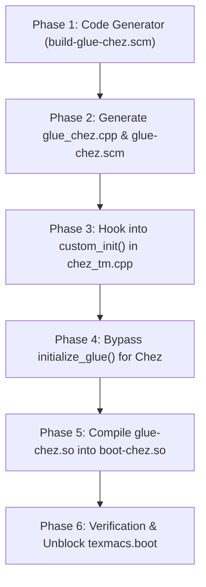

# Architectural & Implementation Plan: Native Chez Glue (`initialize_glue_chez`)

## Executive Summary

This document specifies the migration plan to eliminate runtime glue registration via `initialize_glue()` and replace it with a native Chez Scheme FFI architecture based on `initialize_glue_chez()` (in `src/Scheme/Chez/glue_chez.cpp`), using `Sforeign_symbol` in C++ and `foreign-procedure` in Chez Scheme.

This plan directly fulfills the core prerequisite of **Approach 2 (`texmacs.boot`)** detailed in [`BOOT_FILE_PLAN.md`](file:///Users/king-kong/Documents/GitHub/texmacs/docs/chez/BOOT_FILE_PLAN.md), breaking the circular dependency between heap construction (`Sbuild_heap`) and glue installation, while delivering significant startup performance gains.

---

## 1. Problem Analysis & Motivation

In TeXmacs, approximately 1,180 C++ routines are exposed to Scheme (`tree?`, `url?`, `buffer-tree`, typesetting primitives, etc.).

### Current Flow (`initialize_glue`)
```
start_scheme()
  └── Sbuild_heap(argv[0], custom_init)       [custom_init only registers ~17 base symbols]
initialize_scheme()
  ├── load_scheme_file("boot-chez.so")
  └── initialize_glue()                       [1,180 C++ calls to chez_install_procedure]
        └── Scall3(tm-install-procedure!)     [1,180 dynamic Scheme calls into Chez runtime]
```

### Why `initialize_glue()` Must Be Replaced

1. **Circular Dependency on Heap Construction (`texmacs.boot`)**:
   - Secondary boot files registered via `Sregister_boot_file("texmacs.boot")` are evaluated during `Sbuild_heap()`.
   - Any module evaluated during heap building that calls or references a glue routine fails because `initialize_glue()` has not yet executed.
   - `initialize_glue()` cannot run before `Sbuild_heap()` because `tmscm_install_procedure()` allocates Scheme symbols (`Sstring_to_symbol`), constructs closures, and invokes Scheme code via `Scall3(tm_install_proc, ...)`, all of which segfault before the garbage-collected heap is active.
2. **Cold Boot Overhead**:
   - 1,180 consecutive round-trip calls from C++ into Scheme (`Scall3`) during startup incur significant latency, symbol interning overhead, and nursery GC churn.
3. **Dispatch Indirection**:
   - Dynamic dispatch routes Scheme calls through `(tm-fast-call-N id ...)` or `raw-tm-call-by-name`, indexing into the in-memory array `tm_fast_table[id]`.
   - With native `foreign-procedure`, Chez Scheme's compiler directly emits native machine `call` instructions targeting the C++ function pointer.

---

## 2. Architecture: Before vs. After

```
Current Architecture (Runtime Glue Installation):
┌──────────────────────────┐       Scall3(tm-install-procedure!)
│  initialize_glue()       │ ────────────────────────────────────►  Scheme dynamic evaluation
│  - 1,180 C++ calls       │       (runs AFTER Sbuild_heap)         (allocates closures, populates
│  - populates fast_table  │                                         hashtables at runtime)
└──────────────────────────┘

New Architecture (Static Foreign Registration & AOT FFI):
┌──────────────────────────┐       Sforeign_symbol("tmg_...", ptr)
│  initialize_glue_chez()  │ ────────────────────────────────────►  Chez Foreign Symbol Table
│  (in glue_chez.cpp)      │       (runs in custom_init BEFORE      (Pure C table, NO heap alloc)
└──────────────────────────┘        Sbuild_heap evaluates boot)                 │
                                                                                ▼
┌──────────────────────────┐                                        (foreign-procedure "tmg_..."
│  glue-chez.scm           │ ────────────────────────────────────►   ...) compiled to direct
│  (in boot-chez / .boot)  │       (Compiled AOT to native code)    native CALL instructions
└──────────────────────────┘
```

Chez Scheme allows `Sforeign_symbol()` to be called at any time, including inside `custom_init()` **before** any boot file is evaluated and before heap allocation is enabled. Foreign symbols reside in a standalone C table, completely independent of the Scheme GC heap.

---

## 3. Detailed Component Design

### 3.1 C++ Registration: `src/Scheme/Chez/glue_chez.cpp`

A dedicated file `src/Scheme/Chez/glue_chez.cpp` implements `initialize_glue_chez()`.

```cpp
/******************************************************************************
* MODULE     : glue_chez.cpp
* DESCRIPTION: Static registration of C++ glue procedures for Chez Scheme FFI
******************************************************************************/

#include "chez_tm.hpp"
#include "glue.hpp"

// Forward declarations for core predicates defined in src/Scheme/Scheme/glue.cpp
extern tmscm treeP (tmscm);
extern tmscm contentP (tmscm);
extern tmscm observerP (tmscm);
extern tmscm urlP (tmscm);
extern tmscm modificationP (tmscm);
extern tmscm patchP (tmscm);
extern tmscm blackboxP (tmscm);

// Forward declarations of tmg_* wrappers (generated or included via header)
extern tmscm tmg_texmacs_version_release (tmscm);
extern tmscm tmg_version_beforeP (tmscm, tmscm);
// ... [all 1,180 glue procedures] ...

void
initialize_glue_chez () {
  // 1. Register core predicates from glue.cpp
  Sforeign_symbol ("tmg_treeP",         (void*) treeP);
  Sforeign_symbol ("tmg_contentP",      (void*) contentP);
  Sforeign_symbol ("tmg_observerP",     (void*) observerP);
  Sforeign_symbol ("tmg_urlP",          (void*) urlP);
  Sforeign_symbol ("tmg_modificationP", (void*) modificationP);
  Sforeign_symbol ("tmg_patchP",        (void*) patchP);
  Sforeign_symbol ("tmg_blackboxP",     (void*) blackboxP);

  // 2. Register all generated glue procedures from glue_basic, glue_editor, glue_server
  Sforeign_symbol ("tmg_texmacs_version_release", (void*) tmg_texmacs_version_release);
  Sforeign_symbol ("tmg_version_beforeP",         (void*) tmg_version_beforeP);
  // ...
}
```

*Build System Integration*: `src/CMakeLists.txt` globs `${TEXMACS_SOURCE_DIR}/src/Scheme/Chez/*.cpp` into `${TeXmacs_Chez_SRCS}`, so `glue_chez.cpp` is automatically discovered and compiled into the binary without requiring CMake edits.

### 3.2 Engine Lifecycle Integration: `src/Scheme/Chez/chez_tm.cpp`

1. **Invoke during `custom_init()`**:
   ```cpp
   static void
   custom_init (void) {
     register_foreign_symbols ();
     initialize_glue_chez (); // Registers all C++ glue entry points before boot file evaluation
   }
   ```
2. **Remove `initialize_glue()` in `initialize_scheme()`**:
   ```cpp
   void
   initialize_scheme () {
     register_foreign_symbols ();
     load_scheme_file (boot);
     // Cache Scheme handles (tm_null, etc.)

     // REMOVED: initialize_glue ();
   }
   ```
3. **Deprecate Dynamic Fast Table**:
   - `chez_install_procedure()`, `tm_fast_table`, `tm_fast_proc_count`, and `tm_install_proc` can be removed or guarded with `#ifdef` for Chez.
   - For Guile/TinyScheme engines, `initialize_glue()` in `src/Scheme/Scheme/glue.cpp` remains untouched.

### 3.3 Chez Scheme FFI Bindings: `TeXmacs/progs/kernel/boot/glue-chez.scm`

All `tmg_*` functions in C++ accept and return `tmscm` (`ptr`), which maps to `scheme-object` in Chez FFI.

The bindings are split into two categories based on signature:

#### Category A: Raw / Non-string Procedures (Zero Transcoding Overhead)
Procedures taking and returning trees, integers, booleans, symbols, URLs, or blackbox handles:
```scheme
;; Direct native machine call binding
(define-public tree?
  (foreign-procedure "tmg_treeP" (scheme-object) scheme-object))

(define-public url?
  (foreign-procedure "tmg_urlP" (scheme-object) scheme-object))

(define-public buffer-tree
  (foreign-procedure "tmg_buffer_tree" (scheme-object) scheme-object))
```
Chez Scheme's compiler inlines these `foreign-procedure` calls directly into single assembly `call` instructions.

#### Category B: String-bearing Procedures (UTF-8 Transcoding)
TeXmacs internal string FFI operates on raw 8-bit bytevectors (`Sbytevectorp`), whereas Scheme user code expects native Scheme strings. AOT wrappers perform UTF-8 conversion:
```scheme
(define c-texmacs-version-release
  (foreign-procedure "tmg_texmacs_version_release" (scheme-object) scheme-object))

(define-public (texmacs-version-release arg1)
  (recur-utf8->string (c-texmacs-version-release (recur-string->utf8 arg1))))

(define c-version-before?
  (foreign-procedure "tmg_version_beforeP" (scheme-object scheme-object) scheme-object))

(define-public (version-before? arg1 arg2)
  (recur-utf8->string (c-version-before? (recur-string->utf8 arg1) (recur-string->utf8 arg2))))
```

### 3.4 Automated Generator: `src/Scheme/Glue/build-glue-chez.scm`

Rather than maintaining 1,180 definitions manually, a dedicated generator script processes the existing declarative specifications:
- `src/Scheme/Glue/build-glue-basic.scm`
- `src/Scheme/Glue/build-glue-editor.scm`
- `src/Scheme/Glue/build-glue-server.scm`

The generator script generates two artifacts:
1. `src/Scheme/Chez/glue_chez.cpp`:
   - Emits forward declarations: `extern tmscm tmg_<mangled_name> (tmscm...);`
   - Emits `void initialize_glue_chez ()` with `Sforeign_symbol("tmg_<mangled_name>", (void*) tmg_<mangled_name>);`
2. `TeXmacs/progs/kernel/boot/glue-chez.scm`:
   - Inspects the argument list and return type for `'string`.
   - Generates direct `foreign-procedure` definitions for non-string signatures.
   - Generates optimized transcoding wrappers for string-bearing signatures.

---

## 4. Phased Implementation Roadmap



### Phase 1: Generator Script (`build-glue-chez.scm`)
- Develop `build-glue-chez.scm` (or run via Chez Scheme / Guile).
- Parse the tuples: `(scheme-name c-routine (ret-type . arg-types))`.
- Extract type signatures to determine string transcoding requirements.

### Phase 2: Generation of Artifacts
- Run generator to create:
  - `src/Scheme/Chez/glue_chez.cpp`
  - `TeXmacs/progs/kernel/boot/glue-chez.scm`

### Phase 3: Engine Wiring in `chez_tm.cpp`
- Add declaration `void initialize_glue_chez ();` to `chez_tm.hpp`.
- Call `initialize_glue_chez();` inside `custom_init()`.
- Guard out `initialize_glue();` in `initialize_scheme()`.

### Phase 4: Scheme Bootstrap Integration
- Include `glue-chez.scm` in `TeXmacs/progs/kernel/boot/boot-chez.scm`.
- Compile `boot-chez.scm` to `boot-chez.so`.
- Ensure fallback dynamic installation in `tm-install-procedure!` is bypassed.

### Phase 5: Verification & Benchmarking
- **Headless Test Suite**: Run `all-tests.scm` to verify 100% glue parity and type conversion correctness.
- **Cold Boot Benchmark**: Measure process startup time before and after. Expect a 10–20 ms reduction in engine bootstrap.
- **AOT Image Generation**: Validate that `texmacs.boot` can now be built with `make-boot-file` without missing symbol errors during `Sbuild_heap()`.

---

## 5. Architectural Benefits

| Feature | Legacy `initialize_glue()` | Native `initialize_glue_chez()` |
|---|---|---|
| **Registration Mechanism** | 1,180 `Scall3(tm-install-procedure!)` calls | Direct C `Sforeign_symbol` registration |
| **Execution Point** | After `Sbuild_heap()`, during `initialize_scheme()` | During `custom_init()`, before boot files load |
| **Boot File Compatibility** | Incompatible with `texmacs.boot` (heap crash) | **Fully compatible with secondary boot files** |
| **Dispatch Performance** | Indirect table lookup (`tm_fast_table[id]`) | Direct native machine code `call` instructions |
| **Startup GC Churn** | Creates 1,180 closures & hash entries dynamically | Zero runtime heap allocation (baked in static gen) |
| **Multi-Engine Impact** | Shared with Guile/TinyScheme | Guile and TinyScheme remain 100% untouched |
