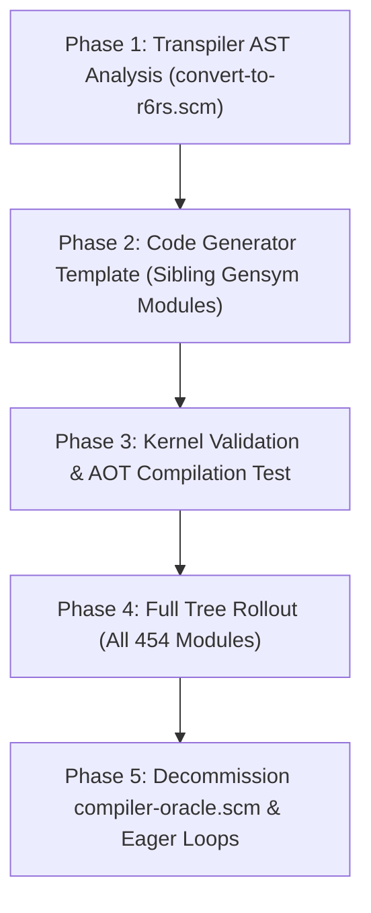

# Architecture Plan: Phased Helper Modules (`for expand`) & Oracle Decommissioning

## Executive Summary

This document specifies the technical design to replace TeXmacs's fragile runtime **Compiler Oracle** ([`src/Scheme/Chez/compiler-oracle.scm`](src/Scheme/Chez/compiler-oracle.scm)) with standard R6RS/Chez Scheme **syntactic phasing** via companion helper modules (`(import (for <helpers> run expand))`).

By statically partitioning macro-dependent procedures into an uninterned sibling module at transpilation time, Chez Scheme's optimizing native compiler can expand macros and compile all 454 modules directly without runtime `eval` injection, ambient global indices, or stateful environment unbinding.

```
+--------------------------------------------------------------------------------------------------+
|                                    Current Architecture (Oracle)                                 |
|                                                                                                  |
|   TeXmacs Source (.scm) ---> Pass 1 (Scan & Index ~10,300 defs into *oracle-defs*)              |
|                                     |                                                            |
|                                     v                                                            |
|                              Pass 2: JIT dynamic `eval` of helpers into memory                   |
|                              Pass 2: `compile-file` with mutated compilation-environment         |
|                              Pass 2: Cleanup via `unbind-ephemerals!`                            |
+--------------------------------------------------------------------------------------------------+
                                                |
                                                v
+--------------------------------------------------------------------------------------------------+
|                              New Architecture (Phased Helper Modules)                            |
|                                                                                                  |
|   TeXmacs Source (.scm) ---> Pass 1: AST Walk (`mc-macro-deps`) partitions file into:            |
|                                        - Sibling Helper Module (Uninterned Gensym)               |
|                                        - Main Module: (import (for <helper> run expand))         |
|                                     |                                                            |
|                                     v                                                            |
|                              Pass 2: Pure Native Chez Scheme `compile-file`                      |
|                              - Zero dynamic `eval`                                              |
|                              - Zero environment contamination                                   |
|                              - Strict lexical encapsulation of private helpers                  |
+--------------------------------------------------------------------------------------------------+
```

---

## 1. Motivation & The Flaws of the Legacy Oracle

### 1.1 The Phasing Mismatch
In Guile 1.8, Scheme execution was completely unphased: procedure definitions and macro transformers lived in a single shared runtime namespace. A macro could freely call any helper procedure defined in the same file or in a previously loaded file.

In Chez Scheme and R6RS, **syntactic phasing is strictly enforced**:
- **Phase 0 (Runtime)**: Normal procedures (`define`, `define-public`, `tm-define`).
- **Phase 1 (Expand-Time / Meta)**: Syntax transformers and macro bodies (`define-syntax`, `define-macro`, `tm-define-macro`).

A macro transformer executing in Phase 1 **cannot invoke Phase 0 runtime procedures** unless they are explicitly imported with phase level `(for ... expand)`.

### 1.2 The Oracle Workaround
To get TeXmacs to compile under Chez Scheme, the port introduced the **Compiler Oracle**:
1. Indexes all ~10,337 definitions across the entire codebase into `*oracle-defs*`.
2. Intercepts macro definitions during compilation and evaluates referenced helper procedures on-the-fly into `(compilation-environment)` using `(eval form env)`.
3. Records all installed identifiers in `*ephemeral-syms*` and strips them out after compilation using `unbind-ephemerals!`.

### 1.3 Critical Architectural Deficiencies
1. **Breaks Module Encapsulation**: The Oracle globally pulls in `define-public` and private `define` from arbitrary external files across the entire codebase, even if the compiling module never declared a `(:use ...)` dependency on that file.
2. **Expand-Time / Runtime Visibility Asymmetries**: Code might compile cleanly because the Oracle magically pulled in an external private helper at expand time, but then crash at runtime because that helper was never exported by its defining module.
3. **Severe Compilation Latency**: Managing `*oracle-defs*`, recursive dependency resolutions, dynamic `eval` invocations, and subsequent unbinding accounts for significant compilation overhead.
4. **Fragile State Contamination**: If unbinding fails or macro state mutates compiler tables during eager evaluation, downstream modules are corrupted.

---

## 2. Technical Mechanics of the Phased Helper Module Pattern

### 2.1 The Two-Module Structure per File

For any module `mod-name` (e.g. `(kernel texmacs tm-define)`):
1. **Static AST Analysis**: Pass 1 inspects all macro definitions in the file to identify every local procedure called inside a macro transformer. These procedures form the **Macro Helper Set**.
2. **Sibling Module Packaging**:
   - The helper procedures are emitted as an expand-time helper module immediately preceding the main module.
   - The main module imports the helper module with `(import (for <helper-module> run expand))`.
   - The main module re-exports any helper that was declared public (`define-public`), while private helpers (`define`) remain strictly unexported.

```scheme
;;; Auto-generated Chez Scheme module from kernel/texmacs/tm-define.scm

;; 1. Sibling Helper Module (Phase 0 & Phase 1 definitions)
(module #{kernel:texmacs:tm-define:helpers g0123} (helper-a helper-b)
  (define (helper-a x) ...)
  (define (helper-b y) ...))

;; 2. Main Module
(module kernel:texmacs:tm-define (my-macro runtime-fn)
  ;; Import helpers into both runtime (phase 0) and expand time (phase 1)
  (import (for #{kernel:texmacs:tm-define:helpers g0123} run expand))

  ;; Phase 1: Macro transformer can natively call helper-a at compile time
  (define-syntax my-macro
    (lambda (stx)
      (syntax-case stx ()
        [(_ val)
         #`'(#,(helper-a (syntax->datum #'val)))])))

  ;; Phase 0: Runtime function can natively call helper-b and helper-a
  (define (runtime-fn x)
    (helper-b (helper-a x))))
```

### 2.2 Chez Scheme Phasing Rule: Sibling vs. Nested

Through empirical testing, a critical Chez Scheme phasing invariant was established:

> **Important Invariant**: An internal child module nested *inside* `(module my-mod ...)` is inherently pinned to **Phase 0** of `my-mod`. Attempting to write `(import (for helpers run expand))` on an internal nested module raises:
> ```
> Exception: attempt to reference out-of-phase identifier helper-a
> ```
> In Chez Scheme, `(for ... run expand)` phase shifting applies exclusively to **sibling/top-level modules and R6RS libraries**.

Therefore, the helper module **must be defined at file scope immediately preceding the main module**, with the `(import (for ... run expand))` placed **inside the main module**.

---

## 3. Strict Encapsulation: Preventing External Imports of Helpers

Because the helper module is defined at file scope, an external module could theoretically attempt to import it directly (`(import kernel:texmacs:tm-define:helpers)`). 

To ensure complete lexical encapsulation, we use **Uninterned Gensym Module Names**:

### 3.1 Mechanism: Uninterned Gensyms (`gensym`)

In Chez Scheme, identifiers read from source code or strings are always **interned** into the system symbol table:
```scheme
(eq? 'my-helpers (string->symbol "my-helpers"))  ;; => #t
(eq? 'my-helpers (gensym "my-helpers"))          ;; => #f (ALWAYS FALSE)
```

By generating the helper module name as an uninterned symbol:
```scheme
(define-syntax define-module-with-helpers
  (lambda (stx)
    (syntax-case stx ()
      ((_ mod-name (helper-exports ...) helper-defs main-body ...)
       (with-syntax ((h-name (datum->syntax #'mod-name (gensym "private-helpers"))))
         #'(begin
             (module h-name (helper-exports ...)
               helper-defs)
             (module mod-name ()
               (import (for h-name run expand))
               main-body ...)))))))
```

#### Properties
1. **Lexically Impossible to Import**: It is physically impossible for any other Scheme file or developer to write an `(import ...)` form that matches the uninterned gensym.
2. **AOT Serialization Support**: Chez Scheme natively preserves uninterned symbol bindings across compiled FASL (`.so`) images.
3. **Zero Runtime Cost**: Resolution occurs via direct pointer identity with zero hashing or symbol-table lookup overhead.

---

## 4. Implementation Plan & Roadmap



### Phase 1: AST Helper Partitioning ([`src/Scheme/Chez/convert-to-r6rs.scm`](src/Scheme/Chez/convert-to-r6rs.scm))
1. In `transpile-module`, inspect the parsed forms of the module.
2. Identify all macro definitions (`*macro-definers*`: `define-syntax`, `define-macro`, `define-public-macro`, `define-module-macro`, `tm-define-macro`).
3. Run the AST dependency walker (`mc-macro-deps`) on each macro transformer to extract the set of referenced function symbols.
4. Partition the module's definition forms into:
   - `helper-defs`: definitions whose names belong to the Macro Helper Set.
   - `main-defs`: remaining definitions and expressions.

### Phase 2: Code Generator Adaptation ([`src/Scheme/Chez/convert-to-r6rs.scm`](src/Scheme/Chez/convert-to-r6rs.scm))
Update `write-module-file`:
- If `helper-defs` is non-empty:
  1. Generate an uninterned name: `h-sym = (gensym (string-append (symbol->string mod-sym) "-helpers"))`.
  2. Emit `(module ,h-sym ,helper-names ,@helper-defs)`.
  3. Emit the main `(module ,mod-sym ...)` with `(import (for ,h-sym run expand))`.
  4. In `mod-sym`'s exports, re-export any helper whose original definition was public (`define-public`, `provide-public`, `tm-define`).
- If `helper-defs` is empty: emit a standard single `(module ,mod-sym ...)` as before.

### Phase 3: Pilot Verification on Kernel Modules
1. Re-transpile the 40 kernel modules (`*kernel-files*`) with the new phased pattern.
2. Compile the kernel modules directly via `compile-file` without `oracle-bring-in-form!`.
3. Verify that macro transformers expand cleanly and runtime procedures execute with 0 failures.

### Phase 4: Full Tree Rollout & Test Suite
1. Run `TeXmacs -compile-modules` across all 454 Scheme modules.
2. Run headless test suite (`TeXmacs -H -x '(run-all-tests)'`) to confirm complete functional parity.

### Phase 5: Decommission the Compiler Oracle
1. Remove `oracle-bring-in-form!`, `oracle-install!`, `oracle-index-tree!`, and `*oracle-defs*` from [`src/Scheme/Chez/compiler-oracle.scm`](src/Scheme/Chez/compiler-oracle.scm).
2. Remove `run-eager-forms!` and `unbind-ephemerals!` from [`src/Scheme/Chez/compiler-helper.scm`](src/Scheme/Chez/compiler-helper.scm).
3. Retire `compiler-oracle.scm` or retain only pure offline AST linters (`mc-free-references`).

---

## 5. Architectural Benefits & Metrics

| Dimension | Legacy Architecture (With Oracle) | New Architecture (Phased Helper Modules) |
|---|---|---|
| **Phase Management** | Dynamic JIT `eval` into compiler memory | Native Chez Scheme `(import (for ... run expand))` |
| **Compiler Environment** | Mutated global RAM with `unbind-ephemerals!` | **100% pure, isolated compilation environments** |
| **Cross-Module Leakage** | High: pulls unimported `define-public` and private `define` across files | **Zero**: private helpers cannot cross file boundaries |
| **Code Size & Complexity** | ~640 lines of Oracle logic + eager eval loop | Direct compiler forms emitted by transpiler |
| **Pass 1 Prescan Overhead** | 0.15 s to index ~10,300 definitions | **0 s** (no global indexing required) |
| **Pass 2 Compilation** | Slow due to dynamic `eval` and unbinding | **Fast, pure native machine code compilation** |
| **R6RS Standard Compliance** | Non-standard environment manipulation | **100% compliant with standard R6RS library phasing** |

---

## 6. Verification Protocol

1. **Unit Compilation Verification**:
   Verify that modules with complex macros (e.g. `kernel/texmacs/tm-define.scm`, `kernel/boot/abbrevs.scm`, `kernel/gui/menu-define.scm`) compile with 0 out-of-phase identifier exceptions.
2. **Encapsulation Verification**:
   Inspect compiled `.so` files using a fresh Chez process; confirm `(top-level-bound? '<helper>)` returns `#f` and `(import <helper-module>)` raises an `unknown module` exception.
3. **Full Build Verification**:
   Run `TeXmacs -compile-modules` with `TEXMACS_RECOMPILE_ALL=1` and verify all 454 modules compile with 0 failures.
4. **Interactive Verification**:
   Launch GUI TeXmacs, verify math typing, buffer navigation, and file saving work with zero regressions.

---

## 7. Implementation Status

`src/Scheme/Chez/convert-to-r6rs-v2.scm` implements §2–§3 for the whole tree. It is
run with `TeXmacs -compile-modules <abs-path>`; a bare `chez --script` cannot work
because boot-chez.scm needs the engine's foreign symbols.

### 7.1 Measured

| scope | result |
| :--- | :--- |
| tier 1 (kernel, 40 modules) | 40/40, 0 failures |
| whole tree (453 modules), warm boot dir | **453/453**, 0 failures |
| whole tree, empty boot dir, pass 1 | 421/453, 32 failures (§7.6) |
| whole tree, empty boot dir, pass 2 | **453/453**, 0 failures |
| whole tree, pre-eval configuration | 453/453 (v1-equivalent; rejected, see §7.4) |

Build time for the kernel tier: ~3–4 s. Whole tree: ~22 s per pass.

Reproduce the whole tree (two passes for an empty boot directory):

```bash
TEXMACS_PATH=$PWD/TeXmacs TEXMACS_BOOT_PATH=/tmp/bv2 \
TEXMACS_V2_TIER=1,2,3,4,5,6,7 TEXMACS_RECOMPILE_ALL=1 \
  build-texmacos/TeXmacs.app/Contents/MacOS/TeXmacs \
  -compile-modules src/Scheme/Chez/convert-to-r6rs-v2.scm
```

`TEXMACS_V2_SHOW_MOVED=1` reports what each module moved. Two diagnostics run
unconditionally: `V2-OPTION-REGS <module> (<keywords>)` for the option
registrations that moved (whole tree: one, `graphics-env` → `(:state-slots)`),
and `V2-NONMOVABLE <module> needs <name>` for a macro that reaches a form the
helper cannot take. The latter reports **0** for the whole tree — it is computed
after the stateful closure, so a `tm-define` the closure moves is not counted
(placed before the closure it reported 19 names, all of them moved a moment
later).

### 7.2 What the emitted module looks like

One file per source file, helper first:

```scheme
(eval-when (compile eval load)
  (module kernel:texmacs:tm-modes$h (texmacs-mode-pred texmacs-mode)
    <deps>
    <definitions the macros call>
    <option registrations this file's own tm-defines need>))

(module kernel:texmacs:tm-modes ()
  (import (for kernel:texmacs:tm-modes$h run expand))
  <deps>
  (export <declared public names>)
  <definitions> <module-provides> <expressions>)
```

The helper's export list is static and contains private names from the source
(`texmacs-mode-pred` is a plain `define`). The main module's export list contains
only what the source declared public.

### 7.3 Mechanisms established by measurement (Chez 10.4.1)

1. **`(for M run expand)` on a sibling `module` gives a transformer M's bindings
   at phase 1 but does not instantiate M.** A macro body that *calls* a helper
   dies with `variable <helper> is not bound`. The helper must be instantiated
   during compilation — hence the `eval-when` wrapper.
2. **`eval-when` is honoured at top level only.** Wrapping a whole `(module ...)`
   form works; inside a module body `(compile)` and `(load)` never fire and only
   `(eval)` does, at instantiation. Wrapping a `define` inside a body is a no-op.
3. **`meta begin` runs before the rest of the module is expanded**, and a
   transformer earlier in the body sees its effect. It accepts definitions and
   applications, but rejects `tm-define` with `invalid context for meta
   definition`; a `let*` body is accepted, so the rejection is specific to that
   macro, not to the shape.
4. **`define-top-level-value` publishes into the interaction environment** and a
   later module in the same unit sees it. `define-top-level-syntax` publishes
   too, but only takes effect if the installing module is imported (and so
   instantiated) before the user is expanded.
5. **`define-macro` must be lexical.** boot-chez.scm's transformer evals its body
   in `(compilation-environment)`; replaced with `(apply (lambda formals body …)
   (cdr (syntax->datum stx)))`, so a transformer resolves its free identifiers
   through its own module's imports.

### 7.4 What the strict model required beyond §2

- **The closure must iterate.** A `tm-define` that a macro calls references other
  `tm-define`s and `define-table`s; one pass selects the first and leaves the
  rest behind (`gui-make` → `gui-make-table` → `gui-make-section-tabs`). The
  closure now runs to a fixed point over `macro-forms ∪ moved-forms`.
- **`define-state` moves like a value definition**, because it expands to
  `(begin (define-public slot …) …)`: the helper can export it and the main
  module imports it back, so one value serves both the expand-time
  `(:state-slots graphics-state)` option and the run-time readers.
- **The ellipsis must not be imported.** abbrevs.scm defines a procedure named
  `...`; once that name holds a variable binding in a module body, `syntax-rules`
  stops reading it as the ellipsis and every macro in the file fails with
  `invalid syntax`.
- **`tm-define`/`tm-define-macro`/`define-table` expand to expressions**, so they
  are emitted with the expressions, not with the definitions; a `begin`-expanding
  macro in the middle of a body leaves the next `define` in expression position.
- **Undeclared cross-module references are inferred.** The sources are not
  module-clean (`tm-preferences.scm` calls `ahash-ref`, exported by
  `ahash-table.scm`, with no `:use`), so the transpiler builds a tree-wide index
  of public names and emits the imports a file omitted.
- **Kernel ordering matters.** `kernel/library/list.scm` now precedes
  `kernel/boot/debug.scm` in `*kernel-files*`: `debug`'s test-group macro calls
  `first`/`second`, and `debug` cannot move later because `srfi.scm` follows it
  and `and-let*` calls `syntax-error` while expanding.
- **`list.scm` has an undeclared dependency on `ahash-table.scm`.** `list.scm`
  calls `ahash-table->list` (and `make-ahash-table`, `ahash-ref`,
  `list->ahash-table`) from `ahash-set->list` / `list->ahash-set` with no `:use`
  for `(kernel boot ahash-table)`. Under the flat Guile namespace that was
  invisible; in a Chez module the reference is compiled into `list.scm`, so if
  the dependency is compiled later the binding never exists and the call raises
  `variable ahash-table->list is not bound` **at run time, not at build time** —
  the build stays green.

  Moving `ahash-table.scm` ahead of `list.scm` in `*kernel-files*` fixes it (the
  inferred-import pass then sees it in `*v2-exports*` and emits a real
  `(import (for kernel:boot:ahash-table run expand))`), but that reorder was
  **reverted**: the tier list is shared with the v1 pipeline and the order is
  not ours to change for a v2-only symptom. The matching runtime reorder in
  `init-texmacs-chez.scm` was reverted with it — and would not have helped
  anyway, because a module's free identifier resolves against that module's
  imports, not against the interaction environment. The dependency is therefore
  still undeclared, and a fresh v2 build reproduces the unbound-variable error
  at boot. The fix belongs with §7.6 — compile in dependency order, or make the
  inference emit an import for a name whose owner is compiled later. Editing
  `list.scm`'s header to declare the `:use` is ruled out by the pristine-sources
  invariant.

Rejected along the way: exporting every plain definition (the export list is the
module's interface); publishing every definition before compiling (that is v1);
a separate helper file loaded first (works, but the `eval-when` form does the same
in one file); an R6RS `library` for the helper (a library cannot import the
ordinary `module`s it needs); translating `tm-define-macro` into `define-syntax`
(loses the `tm-defined-table` registration and is not globally visible).

### 7.5 The option-registration rule (resolved: 7 → 0 failures)

The last seven failures were one cluster:

```text
graphics/graphics-env.scm     Exception in tm-define-sub: unknown option :state-slots
graphics/graphics-group.scm   ┐
graphics/graphics-edit.scm    │
graphics/graphics-menu.scm    ├ 6 cascades
graphics/graphics-kbd.scm     │
graphics/graphics-single.scm  │
graphics/graphics-animate.scm ┘
```

**Cause.** `tm-define` consults `define-option-table` *while it expands* and
raises `unknown option :kw` when the keyword is missing
(`tm-define.scm:274`). `graphics-env.scm` installs the option with
`(ahash-set! define-option-table :state-slots define-option-state-slots)` and
then uses it twelve lines later in `(tm-define (graphics-reset-context cmd)
(:state-slots graphics-state) ...)`. In the emitted file the registration is an
*expression*, so it runs only after the whole body has been expanded — the
option is unknown at the one moment it is needed.

**Rule.** A registration moves into the helper module exactly when the keyword
it installs is used as an option by a `tm-define` / `tm-define-macro` /
`tm-property` in the same file. The helper is instantiated by its `eval-when`
wrapper while the file is compiled, and the main module is expanded afterwards,
so the registration lands before the expansion that needs it.

This is the narrow rule the plan asked for, and it is narrow for a measured
reason: moving *every* registration gives 280/453 with 173 failures, because
`tm-define.scm`'s own fifteen registrations would drag the whole option
vocabulary, and the procedures behind them, across the boundary.

**Implementation** (`convert-to-r6rs-v2.scm`):

- `v2-option-registration?` recognises `(ahash-set! define-option-table :kw handler)`.
- `v2-options-used` collects the option keywords in the body of the file's own
  `tm-define`-family forms (body only, not the head).
- `v2-selected-registrations` keeps the registrations whose keyword appears there.
- The selected registrations *seed the helper closure* like a macro form does,
  so the handler and everything it calls (`define-option-state-slots`, and
  through it `graphics-state`) move with them, and are emitted after the
  helper's definitions.
- `TEXMACS_V2_SHOW_MOVED` / the new `V2-OPTION-REGS` note report the selection.
  In the whole tree exactly one file selects anything: `graphics-env` →
  `(:state-slots)`.

Result: **453/453, 0 failures** for the whole tree; all seven graphics modules
compile, and `graphics-env` itself loads clean. Four of the six cascades
(`graphics-group`, `graphics-edit`, `graphics-menu`, `graphics-kbd`) still emit a
`LOAD-ERROR` during the build, but that is §7.6 and not this rule: the condition
is raised inside a `(module-provide '<dep>)` that the module's own body runs, so
it reports the module that *asked* rather than the one that failed.

### 7.6 What is left: forward dependencies in the tier order

Two facts, both measured, that the 453/453 does not cover.

**1. The build needs a warm boot directory.** Into an *empty* boot directory the
first pass gives 421/453 with 32 failures; a second pass over the same directory
gives 453/453 and a third stays there. So the build is a fixed point reached in
two iterations, not a one-shot.

The 32 first-pass failures are not translation bugs. A declared `:use`
dependency that has not been compiled yet cannot be imported, so the transpiler
emits a runtime `(module-provide '<dep>)` in its place. On a cold directory that
call finds no `.so` and falls back to `(tm-load-file <original Guile source>)`:
`kernel/texmacs/tm-dialogue.scm` and friends get *interpreted* mid-build, fail on
names the module boundary would have provided (`variable npair? is not bound`),
and the module that needed them then fails to compile against the half-populated
result. Root failures of the 32: `config-kbd`, `table-edit`, `format-edit`; the
rest are import cascades. On the second pass the `.so` is there, so the module
being built compiles.

**2. v2 emits ~87 LOAD-ERRORs on every pass; v1 emits 0.** They are swallowed by
the guarded loader (`boot-chez.scm:907`), so they never reach the failure count.
85 of the 87 are a `.so` failing with `variable make-ahash-table is not bound` or
`variable tm-defined-table is not bound`. The condition is attributed to the
module whose *body* made the call, not to the module that failed: verified case,
`graphics-group.so` reports the error, and the backtrace shows
`(module-provide '(graphics graphics-single))` at `graphics-group.scm:4` — a
dependency later in the tier list — so the failing instantiation is
`graphics-single.so`'s.

What is *not* established is why that instantiation fails, and two candidates
fit the evidence equally well: (a) the `.so` loaded is from a previous build of
the directory and was produced when the transpiler emitted a different import
list — the current `graphics-single.scm` does import `tm-define` in both its
modules; or (b) the reference is genuinely unimported because `tm-define` was
resolved at expansion time through the interaction environment rather than
through an import, which is the expand-time/runtime asymmetry §1.3.2 predicted.
Telling them apart needs the `.so` to record the import list it was built with,
or a build into a directory that is wiped between passes.

Either way the reliable conclusion is the same: v2 has no dependency-order
guarantee for `:use` edges, and the `module-provide` fallback loads whatever
`.so` happens to be on disk. The v1 pipeline gets this right through
`module-deps.scm`, which v2 does not read.

Making `module-provide` inert during the verification load — by holding
`compile-export-mode?` across the `load` as well as the `compile-file` — is
**wrong**, measured at 73/453 with 380 failures. That call is the only thing
that pulls a not-yet-compiled dependency in and publishes its exports into the
interaction environment, which is how a later module's free identifier resolves
at run time. The pilot's "no publication" claim holds for the *transpiler*; the
load step publishes, and the build depends on it.

The real fix is the one this pilot deliberately excludes (see the header of
`convert-to-r6rs-v2.scm`): compile in dependency order using the compiler
database and the dependency graph, so that every `:use` edge is a real import
and no `module-provide` is emitted for a module that the run is about to build.

### 7.7 Runtime boot of the v2 tree, and a v1 regression it exposed

A green build says nothing about whether the tree *runs*. Booting the v2 boot
directory headless is the cheap check:

```bash
TEXMACS_PATH=$PWD/TeXmacs TEXMACS_BOOT_PATH=$PWD/build-v2 \
  build-texmacos/TeXmacs.app/Contents/MacOS/TeXmacs -H -q
```

| tree | LOAD-ERROR | `variable ... is not bound` | reaches GUI loop |
| :--- | :--- | :--- | :--- |
| v1 (`build-texmacos/boot`) | 0 | 0 | yes |
| v2, with `ahash-table` ahead of `list.scm` | 0 | 0 | yes |
| v2, with the tier order as shipped | 0 | 1 (`ahash-table->list`) | yes |

The middle row was produced by temporarily moving `ahash-table.scm` ahead of
`list.scm` in `*kernel-files*` (and in the runtime `use-modules` order); both
reorders have been reverted, so the current tree is the third row. The error is
real and silent at build time: `kernel/library/list.scm` calls
`ahash-table->list` with no `:use`, and `ahash-table.scm` is compiled *after*
it, so no import is emitted (§7.4). Until the inference or the dependency order
is fixed, a fresh v2 build boots with that one unbound variable.

The single remaining message in every case is `ERROR: file not found: #f`, which
is `module-deps.scm` missing from the v2 boot directory — v2 never writes that
manifest, and the boot's explicit `use-modules` order makes it unnecessary.

**The v1 pipeline cannot be rebuilt with the current working tree.** This was
found while restoring the build, and it predates the change above. With the
lexical `define-macro` of §7.3 item 5 in `boot-chez.scm`, compiling
`kernel/boot/abbrevs.scm` fails:

```text
Exception: attempt to reference out-of-phase identifier ==
  form: #<syntax == [line 2, char 4419 of .../abbrevs.scm]>
```

`abbrevs.scm` defines `(define-public-macro (for what . body) ...)` whose
transformer calls `==`, a phase-0 binding of the same module. Under the old
`eval`-in-`(compilation-environment)` transformer that resolved through the
interaction environment; applied lexically it is an out-of-phase reference, and
the v1 output — one flat `(module ...)` with no helper — has no way to express
it. Measured: 224 failures from that one root, with either version of
`*kernel-files*`. Restoring `HEAD`'s `boot-chez.scm` gives 453/453 again, so the
two are exactly correlated.

Consequence for the migration: v1 and the lexical `define-macro` are mutually
exclusive. The `.so` files in `build-texmacos/boot` were compiled before that
change landed (2026-11-13 23:15) and are still good, but they cannot be
regenerated from the current tree. Either v2 replaces v1 before the next full
rebuild is needed, or `define-macro` keeps its `eval` form in `boot-chez.scm`
and v2's lexical requirement is met another way.

